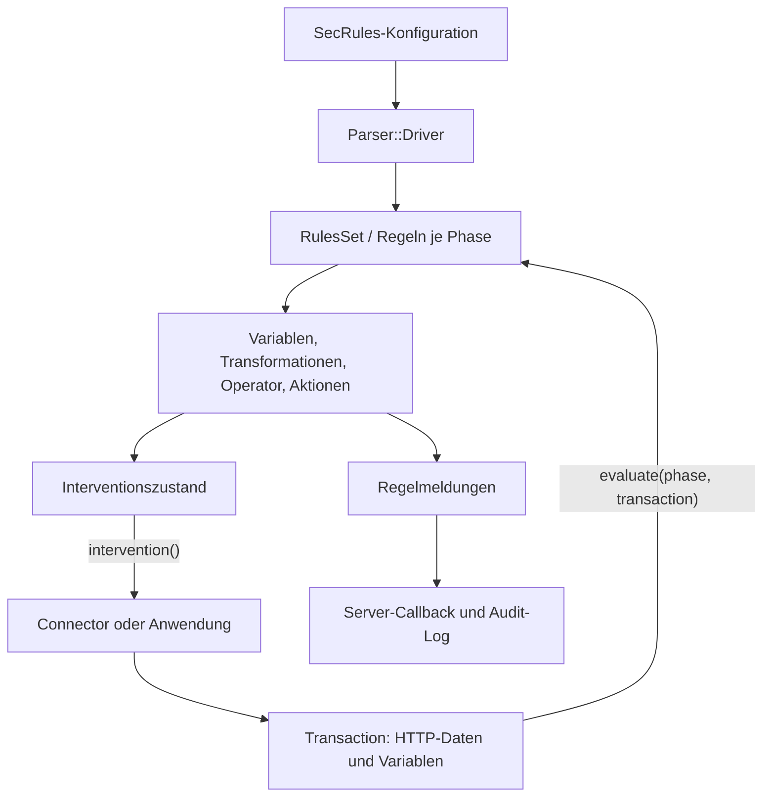

# ModSecurity v3: Architektur und Datenfluss

## Geltungsbereich

Diese Erklärung beruht auf `owasp-modsecurity/ModSecurity`, Branch `v3/master`, Commit **`effb6c0fa031a7bddb3253e0b7ab9ca9a18b5729`**. Alle Quellenverweise unten sind auf diesen Commit festgelegt. Beschrieben wird der gelesene Quellcode; daraus folgt keine Aussage darüber, ob eine bestimmte Installation erfolgreich gebaut wurde, welche optionalen Funktionen dort aktiv sind oder ob ein externer Connector korrekt arbeitet.

Die wichtigsten Einstiegspunkte sind `headers/modsecurity/modsecurity.h`, `headers/modsecurity/rules_set.h`, `headers/modsecurity/transaction.h` und die zugehörigen Implementierungen in `src/`. Für die Sprache und die Speichereigentümerschaft folgt [CPP_GUIDE.md](CPP_GUIDE.md).

## 1. Was dieses Projekt bereitstellt

Dieses Repository enthält **libmodsecurity**, die Bibliothek des ModSecurity-v3-Projekts. Die Bibliothek lädt Regeln in der SecRules-Sprache und verarbeitet HTTP-Daten, die ihr eine Anwendung beziehungsweise ein Connector übergibt. Die serverabhängige Anbindung liegt in getrennten Connector-Projekten. Das Upstream-README nennt dafür beispielsweise `ModSecurity-nginx`. Der Bibliotheksbuild erzeugt `libmodsecurity.la`. Quellen: [Upstream-Abgrenzung][scope], [Bibliotheksziel][lib-target].

Für die Arbeit ergeben sich drei getrennte Fragen: Welche Daten übergibt der Connector? Welche Regeln und Einstellungen wurden geladen? Was macht die Bibliothek mit diesen Daten und Regeln? Ein Aufruf wie `processRequestHeaders()` liest nicht selbst die Header aus Nginx: Die Header werden zuvor mit `addRequestHeader()` in der Transaktion abgelegt. Der Beispielcode führt genau diese Reihenfolge aus. Quellen: [Header-Verarbeitung][request-headers], [Connector-ähnlicher Beispielablauf][example-flow].

Die Bibliothek und eine konkrete Regelkonfiguration erfüllen unterschiedliche Aufgaben. `RulesSet::loadFromUri()` parst eine angegebene Datei; `modsecurity.conf-recommended` liefert unter anderem Engine-, Body- und Fehlerbehandlungsregeln. Diese Datei beginnt mit `SecRuleEngine DetectionOnly`. Aus dem Vorhandensein einer `deny`-Regel darf deshalb kein aktives Blockieren einer konkreten Installation abgeleitet werden: Die Ausführung disruptiver Aktionen ist im Code an den Engine-Zustand gebunden. Quellen: [Regelladen][load], [Empfohlene Konfiguration][recommended], [Aktionsausführung][action-engine].

## 2. Die drei zentralen Objekte

| Objekt | Aufgabe im gelesenen Code | Wichtige Beziehungen |
| --- | --- | --- |
| `modsecurity::ModSecurity` | Initialisiert gemeinsame Collection-Backends, speichert Connector-Information und Log-Callback. | Stellt Collections bereit, auf die Transaktionen zugreifen. Konstruktor und Destruktor verwalten diese Backends. [Quelle][engine] |
| `modsecurity::RulesSet` | Lädt und vereinigt Regeln und Einstellungen; führt die Regeln einer Phase aus. | Erbt von `RulesSetProperties`, enthält `RulesSetPhases`; das Laden verwendet `Parser::Driver`. [Header][rules-api], [Implementierung][load] |
| `modsecurity::Transaction` | Hält Zustand und Daten einer HTTP-Transaktion: URI, Header, Bodies, Variablen, Regelmeldungen und Intervention. | Erhält Zeiger auf `ModSecurity` und `RulesSet`; enthält die transaktionsbezogenen Collections und Body-Prozessoren. [Header][transaction-api], [Konstruktor/Destruktor][transaction-life] |

**Lebensdauer aus der Implementierung abgeleitet:** `Transaction` speichert `m_ms` und `m_rules`, löscht diese Objekte im Destruktor jedoch nicht. Die übergebenen Engine- und Ruleset-Objekte müssen daher während ihrer Nutzung durch die Transaktion gültig bleiben. Das Chunk-Beispiel beendet zuerst die Transaktion, dann das Ruleset und zuletzt die Engine. Eine zusätzliche automatische Besitzübernahme durch `Transaction` ist hier nicht implementiert. Quellen: [Konstruktor/Destruktor][transaction-life], [Beispiel-Cleanup][example-cleanup].

`Rules` und `RulesSet` sind verschiedene Typen. `Rules` enthält einen Vektor von `std::shared_ptr<Rule>` und stellt unter anderem `insert()`, `append()` und `at()` bereit. `RulesSet` ist der Einstiegspunkt für `loadFromUri()`, `load()` und `evaluate()`. Für neue Erklärungen sind diese tatsächlichen Header maßgeblich. Quellen: [Rules][rules-bucket], [RulesSet][rules-api].

## 3. Wie Konfiguration zu ausführbaren Regeln wird

`RulesSet::loadFromUri()` erzeugt einen `Parser::Driver`, lässt die Datei parsen und übernimmt anschließend Regeln und Eigenschaften über `merge()`. Bei einem von diesem Pfad erkannten Parsefehler liefert die Methode `-1`; Erfolg liefert eine Regelanzahl. Der Driver liest den Dateiinhalt, startet den Scanner und ruft `yy::seclang_parser::parse()` auf. Quellen: [RulesSet-Ladepfad][load], [Driver-Parsepfad][driver-parse].

Der Driver ordnet Regeln ihren Phasen zu. Er erhält neue Regeln als `std::unique_ptr<RuleWithActions>`. Bei einer Kette überträgt er diesen Besitz in `m_chainedRuleChild`, das im Header als `std::shared_ptr<RuleWithActions>` deklariert ist; das Elternobjekt wird über einen nicht besitzenden Zeiger referenziert. Auch nicht verkettete Einstiegsregeln werden in `std::shared_ptr` überführt und in die Phasensammlung eingefügt. Der Driver prüft an dieser Stelle außerdem fehlende beziehungsweise doppelte Regel-IDs und weist disruptive Aktionen in nachfolgenden Kettengliedern zurück. Quellen: [Driver::addSecRule()][driver-rules], [Kettenfelder][chain-fields].

Das Diagramm fasst die Aufrufe im Ladepfad, in `Transaction`, `RulesSet::evaluate()`, `RuleWithOperator::evaluate()` und im Logging zusammen. Es stellt keine eigenständig laufenden Dienste dar. Quellen: [Laden][load], [Phasenausführung][rules-evaluate], [Regelausführung][rule-evaluate], [Intervention][intervention], [Logging][logging].

## 4. Lebenszyklus einer HTTP-Transaktion

Der übliche vollständige Ablauf, solange die Anwendung die Verarbeitung fortsetzt, ist in der folgenden Tabelle zusammengefasst. Das Beispiel `examples/using_bodies_in_chunks/simple_request.cc` zeigt die API-Reihenfolge einschließlich wiederholter Interventionsabfragen. Wie ein produktiver Connector bei einer Intervention den HTTP-Ablauf beendet oder umleitet, gehört zu dessen Implementierung. Quellen: [Beispiel, erste Hälfte][example-flow], [Beispiel, zweite Hälfte][example-cleanup].

| Schritt | C++-Einstiegspunkt | Was die Implementierung tut |
| --- | --- | --- |
| 1. Verbindung übergeben | `processConnection(client, clientPort, server, serverPort)` | Setzt Verbindungsvariablen und führt `ConnectionPhase` aus. [Quelle][connection] |
| 2. Request-Zeile übergeben | `processURI(uri, method, httpVersion)` | Bildet URI-, Methoden-, Protokoll- und Query-Variablen; extrahiert GET-Argumente. Hier erfolgt **kein** `RulesSet::evaluate(UriPhase, …)`. [Quelle][uri] |
| 3. Request-Header sammeln | `addRequestHeader(...)` | Füllt Header-Variablen, verarbeitet unter anderem Cookies und erkennt bestimmte Body-Typen. [Quelle][request-headers] |
| 4. Request-Header prüfen | `processRequestHeaders()` | Führt bei nicht deaktivierter Engine `RequestHeadersPhase` aus. [Quelle][request-phase] |
| 5. Request-Body sammeln | `appendRequestBody(buffer, length)` | Schreibt Bytes in `m_requestBody`; behandelt das Größenlimit bereits beim Anhängen. [Quelle][request-append] |
| 6. Request-Body prüfen | `processRequestBody()` | Verarbeitet Body-Formate und Fehlervariablen; führt abhängig von Engine und Body-Zugriff `RequestBodyPhase` aus. [Quelle][request-body] |
| 7. Response-Header übergeben und prüfen | `addResponseHeader(...)`, `processResponseHeaders(status, protocol)` | Füllt Response-Variablen und führt bei nicht deaktivierter Engine `ResponseHeadersPhase` aus. [Quelle][response-headers] |
| 8. Response-Body sammeln und prüfen | `appendResponseBody(...)`, `processResponseBody()` | Berücksichtigt Größenlimit, Response-Body-Zugriff und konfigurierte MIME-Typen; führt gegebenenfalls `ResponseBodyPhase` aus. [Quelle][response-body] |
| 9. Logging abschließen | `processLogging()` | Kehrt bei deaktivierter Engine sofort zurück; sonst führt es `LoggingPhase` aus und prüft bei vorhandenem Audit-Log die Speicherung. [Quelle][logging] |
| 10. Ressourcen freigeben | Destruktor beziehungsweise `msc_transaction_cleanup()` | Gibt Transaktionsressourcen frei; das API-Cleanup ruft `delete transaction` auf. [Destruktor][transaction-life], [C-Cleanup][c-cleanup] |

### Zwei unterschiedliche Nummerierungen

Die Werte von `enum Phases` sind nicht identisch mit den gebräuchlichen SecRules-Phasennummern. Das Enum enthält zusätzlich `UriPhase`. `actions::Phase::init()` übersetzt die Regelangabe in den internen Wert. Quellen für die gesamte Zuordnung: [Enum][phases], [Übersetzung][phase-action].

| Interner Name | Interner Enum-Wert | SecRules-Angabe im untersuchten Code |
| --- | ---: | --- |
| `ConnectionPhase` | 0 | `phase:0` |
| `UriPhase` | 1 | Keine eigene Zuordnung in `Phase::init()`; `processURI()` befüllt Daten ohne diesen Regelaufruf. |
| `RequestHeadersPhase` | 2 | `phase:1` |
| `RequestBodyPhase` | 3 | `phase:2`, Alias `request` |
| `ResponseHeadersPhase` | 4 | `phase:3` |
| `ResponseBodyPhase` | 5 | `phase:4`, Alias `response` |
| `LoggingPhase` | 6 | `phase:5`, Alias `logging` |

Deshalb muss bei einer Zahl in Logs, Tests oder C++-Code immer geklärt werden, welche Nummerierung gemeint ist. Auch der Header-Parametername `protocol` bei `processURI()` ist keine ausreichende Erklärung: Die Implementierung benennt den zweiten Parameter `method`, und die Beispiele übergeben dort etwa `"GET"`. Quellen: [Header][transaction-api], [Implementierung][uri], [Beispiel][example-flow].

## 5. Was bei der Regelauswertung geschieht

`RulesSet::evaluate()` wählt zuerst die Regelsammlung der übergebenen internen Phase. Die Schleife berücksichtigt `allow`, `skip`, Marker sowie konfigurierte und transaktionsbezogene Ausnahmen. Nach der Ausführung einer Regel werden Match-Variablen bereinigt. Sobald eine disruptive Intervention gesetzt ist, beendet die Schleife die aktuelle Phasenauswertung. Quelle: [RulesSet::evaluate()][rules-evaluate].

`RuleWithOperator::evaluate()` ermittelt die endgültigen Zielvariablen, lässt diese ihre Werte auflösen, berücksichtigt ausgeschlossene Ziele und wendet Transformationen an. Der Operator prüft anschließend die so erzeugten Werte. Bei einem Treffer werden Match-Informationen und Herkunftsangaben ergänzt. Die Funktion unterscheidet Aktionen, die unabhängig vom Gesamtergebnis einer Kette ausgeführt werden, von Aktionen nach vollständigem Kettentreffer. Die Behauptung, sämtliche Aktionen liefen erst nach erfolgreicher Gesamtkette, wäre daher falsch. Quellen: [Regelauswertung][rule-evaluate], [Unabhängige und vollständige Aktionen][rule-actions].

Transformationen gehören zum Vergleichspfad. `executeTransformations()` beginnt mit einer Kopie des Eingabewerts, berücksichtigt Standardaktionen und `t:none` und stellt mit `multiMatch` mehrere Vergleichszustände bereit. Daraus folgt nicht, dass die ursprüngliche HTTP-Nachricht im Webserver entsprechend umgeschrieben wird. Quellen: [Transformationen][transformations], [Operatoraufruf und Match-Verarbeitung][rule-evaluate].

Eine disruptive Aktion wie `deny` setzt in der Transaktion Status, Logtext und `disruptive`. Die Entscheidung wird anschließend über `Transaction::intervention()` an den API-Verwender übergeben. `RuleWithActions::executeAction()` führt disruptive Aktionen nur bei `EnabledRuleEngine` aus. Quellen: [Deny][deny], [Engine-Abfrage][action-engine], [Intervention][intervention].

## 6. Request- und Response-Bodies

### Auswahl des Request-Prozessors

Die Header-Verarbeitung erkennt anhand von `Content-Type` die Typen Multipart und URL-encoded. JSON und XML werden dagegen über `ctl:requestBodyProcessor=JSON` beziehungsweise `XML` gewählt: Die Aktionsklassen setzen `m_requestBodyProcessor`. `modsecurity.conf-recommended` enthält dazu passende Regeln in Phase 1. Quellen: [Header-Erkennung][request-type], [JSON-Aktion][json-selection], [XML-Aktion][xml-selection], [Konfigurationsregeln][recommended].

| Body-Pfad | Verarbeitung in `processRequestBody()` | Bedingung beziehungsweise Ergebnis |
| --- | --- | --- |
| URL-encoded | `extractArguments("POST", ...)` | Verwendet `m_requestBodyType == WWWFormUrlEncoded`; berücksichtigt das Limit ohne Dateien. |
| Multipart | Lokales `Multipart`-Objekt mit `init()`, `process()`, `multipart_complete()` | Übernimmt Parserfehler und die Größe der Daten ohne Dateien. |
| JSON | `m_json->init()`, `processChunk()`, `complete()` | Unter `WITH_YAJL`; berücksichtigt gegebenenfalls die konfigurierte JSON-Tiefengrenze. |
| XML | `m_xml->init()`, `processChunk()`, `complete()` | Unter `WITH_LIBXML2`. |

Quelle für diese Tabelle: [gesamter Request-Body-Pfad][request-body]. Die Variablen `REQBODY_ERROR`, `REQBODY_PROCESSOR_ERROR` und zugehörige Meldungen werden im Parserpfad gesetzt. Die Beispielkonfiguration enthält Regeln, die solche Fehler auswerten. Ein gesetztes Fehlerflag ist nicht mit einer bereits vom Webserver ausgeführten Sperre gleichzusetzen. Quellen: [Body-Pfad][request-body], [Fehlerregeln der Konfiguration][recommended-errors].

### Puffern, prüfen und begrenzen

`appendRequestBody()` und `appendResponseBody()` akzeptieren auch einzelne Datenstücke, schreiben diese aber in den jeweiligen Stream. `processRequestBody()` greift anschließend auf `m_requestBody.str()` zu. Die vorhandene Chunk-API ist deshalb kein Beleg dafür, dass jede SecRule sofort auf jedes neue Netzwerkpaket angewendet wird. Quellen: [Request-Anhängen][request-append], [Request-Auswertung][request-body], [Response-Verarbeitung][response-body].

Größenlimits können schon beim Anhängen relevant werden. Im `ProcessPartial`-Zweig wird nur der verbleibende Platz geschrieben und `false` zurückgegeben. Im Reject-Zweig kann eine Intervention mit Status 403 gesetzt werden, während die Append-Methode trotzdem `true` zurückgibt. Für eine korrekte Integration sind also Rückgabewert **und** Interventionsabfrage getrennt zu betrachten. Quellen: [Request-Limit][request-append], [Response-Limit][response-body].

Der genaue Ort einer Prüfung zählt: In `processRequestBody()` stehen die Engine-Abfrage am Anfang, die Formatverarbeitung danach und die Prüfung von `SecRequestBodyAccess` beziehungsweise dessen transaktionsbezogenem Override erst weiter unten vor der Regelphase. Die Response-Auswertung prüft zusätzlich den Response-Body-Zugriff und die MIME-Auswahl vor `ResponseBodyPhase`. Diese Beschreibung darf nicht zu einer pauschalen Aussage über den Pufferungsablauf eines externen Connectors erweitert werden. Quellen: [Request-Body][request-body], [Response-Body][response-body].

## 7. Interventionen richtig verstehen

`ModSecurityIntervention` enthält `status`, `pause`, `url`, `log` und `disruptive`. `Transaction::intervention()` liefert im untersuchten Code den disruptiven Zustand zurück. Im aktiven Zweig kopiert es URL und Logtext mittels `strdup`, überträgt Status und Disruptiv-Flag, markiert die Transaktion als unterbrochen und setzt den internen Interventionszustand zurück. Ein erneuter Aufruf ist daher keine garantiert identische Abfrage desselben Ergebnisses. Quellen: [Struktur und Hilfsfunktionen][intervention-type], [Implementierung][intervention].

Für den Verwender ist dies ein Auftrag zur Reaktion. Die Bibliothek setzt nicht an dieser Stelle einen HTTP-Status im Webserver. Das Chunk-Beispiel wertet die Rückgabe aus und zeigt Status beziehungsweise Redirect an; die produktive Wirkung muss im Connector geprüft werden. Der C-Einstiegspunkt `msc_intervention_cleanup()` gibt die kopierten Puffer frei und initialisiert die Struktur erneut. Quellen: [Beispiel-Helfer][example-intervention], [C-Cleanup][c-cleanup].

**Konkrete Abweichung zwischen Kommentar und Code:** Der Kommentar zu `intervention()` verspricht bei Erfolg initialisierte Felder. Der Funktionskörper weist `pause` jedoch nicht zu. Für neu geschriebenen Aufrufercode ist eine vollständig initialisierte Struktur daher die nachvollziehbare Vorsichtsmaßnahme. Diese Beobachtung ist eine Quellcodefeststellung, kein ausgeführter Fehlertest. Quellen: [Kommentar und Implementierung][intervention], [Struktur][intervention-type].

## 8. Variablen, Collections und Logs

Request- und Response-Eigenschaften werden in an der Transaktion verankerten Variablen abgelegt. `VariableValue` enthält Collection, Schlüssel, Wert und Herkunftsangaben; die Regelauswertung verwendet diese Angaben unter anderem für Match-Referenzen. Dies erklärt, warum Änderungen an der Dekodierung oder an Offsets nicht nur den Vergleichswert, sondern auch Diagnoseausgaben beeinflussen können. Quellen: [VariableValue][variable-value], [Match-Auswertung][rule-evaluate], [URI-Verarbeitung][uri].

`ModSecurity` erzeugt die Backends für `GLOBAL`, `RESOURCE`, `IP`, `SESSION` und `USER`. Mit `WITH_LMDB` verwendet dieser Konstruktor LMDB, andernfalls `InMemoryPerProcess`. `collection::Collections` erhält Zeiger auf diese Backends und erzeugt zusätzlich ein eigenes In-Memory-Backend für `TX`, das im Destruktor wieder gelöscht wird. Persistenz darf daher nicht pauschal für jede Collection und jeden Build versprochen werden. Quellen: [Engine-Backends][engine], [Transaktions-Collections][collections].

Es gibt mehrere unterschiedliche Logwege. `Transaction::debug()` leitet über das Ruleset zum Debug-Log weiter. `ModSecurity::serverLog()` ruft den konfigurierten Callback mit Text oder `RuleMessage` auf. `processLogging()` kehrt bei deaktivierter Engine vor der Logging-Phase und der Audit-Auswahl zurück. Andernfalls wertet es Phase 5 aus und ruft bei vorhandenem `m_auditLog` dessen `AuditLog::saveIfRelevant()` auf; dort werden unter anderem Audit-Status, Relevanz und Writer berücksichtigt. Ein Callback-Ereignis allein beweist somit nicht, dass ein Audit-Datensatz geschrieben wurde. Quellen: [Debug-Weiterleitung][transaction-debug], [Server-Callback][callback], [Logging-Phase][logging], [Audit-Auswahl][audit].

## 9. Grenzen dieser Architekturübersicht

Die Übersicht beschreibt den zentralen Ablauf und seine belegten Verzweigungen. Sie ersetzt bei einer Änderung weder das Lesen der betroffenen Operator-, Aktions- und Variablenimplementierung noch die passenden Regressionstests. Aus ihr werden keine Garantien über sämtliche Eingaben, Thread-Sicherheit, externe Connector-Versionen oder die Wirksamkeit eines geladenen Regelwerks abgeleitet. Diese Punkte müssen am konkreten Auftrag geprüft und als offen gekennzeichnet werden, solange entsprechende Belege fehlen.

Besondere Stolperstellen für neue Chats sind die veralteten API-Namen in einigen Kommentar-Beispielen, die beiden Phasennummerierungen, der Unterschied zwischen Regelmatch und Intervention sowie die getrennten Bedeutungen von Chunk-Zufuhr und Regelauswertung. Die oben angegebenen Implementierungen sind dafür die Einstiegspunkte.

[scope]: https://github.com/owasp-modsecurity/ModSecurity/blob/effb6c0fa031a7bddb3253e0b7ab9ca9a18b5729/README.md#L21-L46
[lib-target]: https://github.com/owasp-modsecurity/ModSecurity/blob/effb6c0fa031a7bddb3253e0b7ab9ca9a18b5729/src/Makefile.am#L1-L14
[engine]: https://github.com/owasp-modsecurity/ModSecurity/blob/effb6c0fa031a7bddb3253e0b7ab9ca9a18b5729/src/modsecurity.cc#L62-L109
[rules-api]: https://github.com/owasp-modsecurity/ModSecurity/blob/effb6c0fa031a7bddb3253e0b7ab9ca9a18b5729/headers/modsecurity/rules_set.h#L49-L107
[transaction-api]: https://github.com/owasp-modsecurity/ModSecurity/blob/effb6c0fa031a7bddb3253e0b7ab9ca9a18b5729/headers/modsecurity/transaction.h#L335-L419
[transaction-life]: https://github.com/owasp-modsecurity/ModSecurity/blob/effb6c0fa031a7bddb3253e0b7ab9ca9a18b5729/src/transaction.cc#L113-L182
[rules-bucket]: https://github.com/owasp-modsecurity/ModSecurity/blob/effb6c0fa031a7bddb3253e0b7ab9ca9a18b5729/headers/modsecurity/rules.h#L41-L87
[load]: https://github.com/owasp-modsecurity/ModSecurity/blob/effb6c0fa031a7bddb3253e0b7ab9ca9a18b5729/src/rules_set.cc#L50-L109
[driver-parse]: https://github.com/owasp-modsecurity/ModSecurity/blob/effb6c0fa031a7bddb3253e0b7ab9ca9a18b5729/src/parser/driver.cc#L128-L198
[driver-rules]: https://github.com/owasp-modsecurity/ModSecurity/blob/effb6c0fa031a7bddb3253e0b7ab9ca9a18b5729/src/parser/driver.cc#L76-L124
[chain-fields]: https://github.com/owasp-modsecurity/ModSecurity/blob/effb6c0fa031a7bddb3253e0b7ab9ca9a18b5729/headers/modsecurity/rule_with_actions.h#L106-L109
[rules-evaluate]: https://github.com/owasp-modsecurity/ModSecurity/blob/effb6c0fa031a7bddb3253e0b7ab9ca9a18b5729/src/rules_set.cc#L121-L232
[rule-evaluate]: https://github.com/owasp-modsecurity/ModSecurity/blob/effb6c0fa031a7bddb3253e0b7ab9ca9a18b5729/src/rule_with_operator.cc#L199-L353
[rule-actions]: https://github.com/owasp-modsecurity/ModSecurity/blob/effb6c0fa031a7bddb3253e0b7ab9ca9a18b5729/src/rule_with_actions.cc#L202-L295
[transformations]: https://github.com/owasp-modsecurity/ModSecurity/blob/effb6c0fa031a7bddb3253e0b7ab9ca9a18b5729/src/rule_with_actions.cc#L327-L441
[action-engine]: https://github.com/owasp-modsecurity/ModSecurity/blob/effb6c0fa031a7bddb3253e0b7ab9ca9a18b5729/src/rule_with_actions.cc#L299-L324
[deny]: https://github.com/owasp-modsecurity/ModSecurity/blob/effb6c0fa031a7bddb3253e0b7ab9ca9a18b5729/src/actions/disruptive/deny.cc#L31-L45
[phases]: https://github.com/owasp-modsecurity/ModSecurity/blob/effb6c0fa031a7bddb3253e0b7ab9ca9a18b5729/headers/modsecurity/modsecurity.h#L97-L170
[phase-action]: https://github.com/owasp-modsecurity/ModSecurity/blob/effb6c0fa031a7bddb3253e0b7ab9ca9a18b5729/src/actions/phase.cc#L25-L72
[connection]: https://github.com/owasp-modsecurity/ModSecurity/blob/effb6c0fa031a7bddb3253e0b7ab9ca9a18b5729/src/transaction.cc#L227-L250
[uri]: https://github.com/owasp-modsecurity/ModSecurity/blob/effb6c0fa031a7bddb3253e0b7ab9ca9a18b5729/src/transaction.cc#L337-L443
[request-headers]: https://github.com/owasp-modsecurity/ModSecurity/blob/effb6c0fa031a7bddb3253e0b7ab9ca9a18b5729/src/transaction.cc#L492-L598
[request-type]: https://github.com/owasp-modsecurity/ModSecurity/blob/effb6c0fa031a7bddb3253e0b7ab9ca9a18b5729/src/transaction.cc#L576-L589
[request-phase]: https://github.com/owasp-modsecurity/ModSecurity/blob/effb6c0fa031a7bddb3253e0b7ab9ca9a18b5729/src/transaction.cc#L461-L471
[request-body]: https://github.com/owasp-modsecurity/ModSecurity/blob/effb6c0fa031a7bddb3253e0b7ab9ca9a18b5729/src/transaction.cc#L674-L871
[request-append]: https://github.com/owasp-modsecurity/ModSecurity/blob/effb6c0fa031a7bddb3253e0b7ab9ca9a18b5729/src/transaction.cc#L929-L971
[response-headers]: https://github.com/owasp-modsecurity/ModSecurity/blob/effb6c0fa031a7bddb3253e0b7ab9ca9a18b5729/src/transaction.cc#L992-L1097
[response-body]: https://github.com/owasp-modsecurity/ModSecurity/blob/effb6c0fa031a7bddb3253e0b7ab9ca9a18b5729/src/transaction.cc#L1117-L1230
[logging]: https://github.com/owasp-modsecurity/ModSecurity/blob/effb6c0fa031a7bddb3253e0b7ab9ca9a18b5729/src/transaction.cc#L1304-L1346
[intervention]: https://github.com/owasp-modsecurity/ModSecurity/blob/effb6c0fa031a7bddb3253e0b7ab9ca9a18b5729/src/transaction.cc#L1350-L1389
[intervention-type]: https://github.com/owasp-modsecurity/ModSecurity/blob/effb6c0fa031a7bddb3253e0b7ab9ca9a18b5729/headers/modsecurity/intervention.h#L23-L62
[c-cleanup]: https://github.com/owasp-modsecurity/ModSecurity/blob/effb6c0fa031a7bddb3253e0b7ab9ca9a18b5729/src/transaction.cc#L2153-L2195
[json-selection]: https://github.com/owasp-modsecurity/ModSecurity/blob/effb6c0fa031a7bddb3253e0b7ab9ca9a18b5729/src/actions/ctl/request_body_processor_json.cc#L28-L35
[xml-selection]: https://github.com/owasp-modsecurity/ModSecurity/blob/effb6c0fa031a7bddb3253e0b7ab9ca9a18b5729/src/actions/ctl/request_body_processor_xml.cc#L28-L35
[recommended]: https://github.com/owasp-modsecurity/ModSecurity/blob/effb6c0fa031a7bddb3253e0b7ab9ca9a18b5729/modsecurity.conf-recommended#L1-L37
[recommended-errors]: https://github.com/owasp-modsecurity/ModSecurity/blob/effb6c0fa031a7bddb3253e0b7ab9ca9a18b5729/modsecurity.conf-recommended#L64-L98
[example-flow]: https://github.com/owasp-modsecurity/ModSecurity/blob/effb6c0fa031a7bddb3253e0b7ab9ca9a18b5729/examples/using_bodies_in_chunks/simple_request.cc#L147-L226
[example-cleanup]: https://github.com/owasp-modsecurity/ModSecurity/blob/effb6c0fa031a7bddb3253e0b7ab9ca9a18b5729/examples/using_bodies_in_chunks/simple_request.cc#L225-L282
[example-intervention]: https://github.com/owasp-modsecurity/ModSecurity/blob/effb6c0fa031a7bddb3253e0b7ab9ca9a18b5729/examples/using_bodies_in_chunks/simple_request.cc#L95-L129
[variable-value]: https://github.com/owasp-modsecurity/ModSecurity/blob/effb6c0fa031a7bddb3253e0b7ab9ca9a18b5729/headers/modsecurity/variable_value.h#L38-L125
[collections]: https://github.com/owasp-modsecurity/ModSecurity/blob/effb6c0fa031a7bddb3253e0b7ab9ca9a18b5729/src/collection/collections.cc#L37-L56
[transaction-debug]: https://github.com/owasp-modsecurity/ModSecurity/blob/effb6c0fa031a7bddb3253e0b7ab9ca9a18b5729/src/transaction.cc#L196-L204
[callback]: https://github.com/owasp-modsecurity/ModSecurity/blob/effb6c0fa031a7bddb3253e0b7ab9ca9a18b5729/src/modsecurity.cc#L193-L212
[audit]: https://github.com/owasp-modsecurity/ModSecurity/blob/effb6c0fa031a7bddb3253e0b7ab9ca9a18b5729/src/audit_log/audit_log.cc#L278-L325
