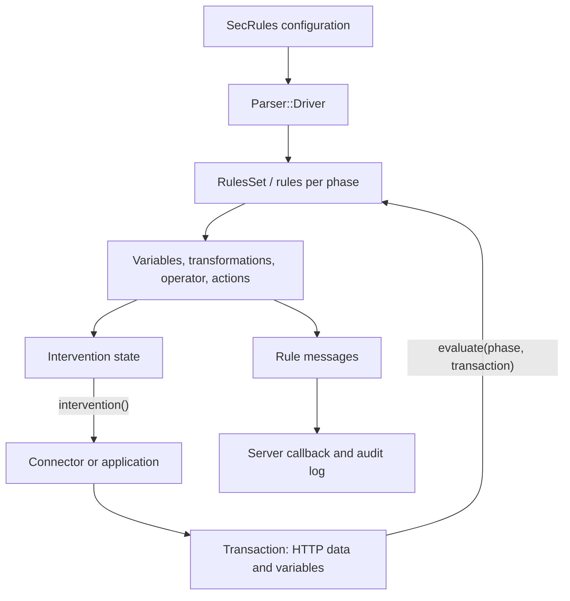

# ModSecurity v3: architecture and data flow

## Scope

This explanation is based on `owasp-modsecurity/ModSecurity`, branch `v3/master`, commit **`effb6c0fa031a7bddb3253e0b7ab9ca9a18b5729`**. All source references below are pinned to this commit. The document describes the source code that was inspected; it does not establish whether a particular installation was built successfully, which optional features are enabled in that installation, or whether an external connector works correctly.

The main entry points are `headers/modsecurity/modsecurity.h`, `headers/modsecurity/rules_set.h`, `headers/modsecurity/transaction.h`, and their implementations in `src/`. For language features and memory ownership, continue with [cpp-guide.md](cpp-guide.md).

## 1. What this project provides

This repository contains **libmodsecurity**, the library of the ModSecurity v3 project. The library loads rules written in the SecRules language and processes HTTP data supplied by an application or connector. Server-specific integration lives in separate connector projects. The upstream README lists `ModSecurity-nginx` as one example. The library build produces `libmodsecurity.la`. Sources: [upstream scope][scope], [library target][lib-target].

The work therefore involves three separate questions: What data does the connector provide? Which rules and settings have been loaded? What does the library do with those data and rules? A call such as `processRequestHeaders()` does not read headers from Nginx itself: the headers are first stored in the transaction through `addRequestHeader()`. The example code follows precisely this order. Sources: [header processing][request-headers], [example connector-style sequence][example-flow].

The library and a particular rule configuration serve different purposes. `RulesSet::loadFromUri()` parses a specified file; `modsecurity.conf-recommended` supplies engine settings, body settings, and error-handling rules, among other things. This file starts with `SecRuleEngine DetectionOnly`. The presence of a `deny` rule therefore does not establish that a particular installation actively blocks requests: the code makes execution of disruptive actions conditional on the engine state. Sources: [rule loading][load], [recommended configuration][recommended], [action execution][action-engine].

## 2. The three central objects

| Object | Role in the inspected code | Important relationships |
| --- | --- | --- |
| `modsecurity::ModSecurity` | Initializes shared collection backends and stores connector information and the logging callback. | Provides collections used by transactions. Its constructor and destructor manage these backends. [Source][engine] |
| `modsecurity::RulesSet` | Loads and merges rules and settings; executes the rules for a phase. | Inherits from `RulesSetProperties`, contains `RulesSetPhases`, and uses `Parser::Driver` for loading. [Header][rules-api], [implementation][load] |
| `modsecurity::Transaction` | Holds the state and data of an HTTP transaction: URI, headers, bodies, variables, rule messages, and intervention state. | Receives pointers to `ModSecurity` and `RulesSet`; contains transaction-specific collections and body processors. [Header][transaction-api], [constructor/destructor][transaction-life] |

**Lifetime inferred from the implementation:** `Transaction` stores `m_ms` and `m_rules` but does not delete these objects in its destructor. The supplied engine and ruleset objects must therefore remain valid while the transaction uses them. The chunked-body example destroys the transaction first, then the ruleset, and finally the engine. No additional automatic transfer of ownership to `Transaction` is implemented here. Sources: [constructor/destructor][transaction-life], [example cleanup][example-cleanup].

`Rules` and `RulesSet` are different types. `Rules` contains a vector of `std::shared_ptr<Rule>` and provides methods including `insert()`, `append()`, and `at()`. `RulesSet` is the entry point for `loadFromUri()`, `load()`, and `evaluate()`. New explanations should follow these actual headers. Sources: [Rules][rules-bucket], [RulesSet][rules-api].

## 3. How configuration becomes executable rules

`RulesSet::loadFromUri()` creates a `Parser::Driver`, has it parse the file, and then takes in the rules and properties through `merge()`. For a parse error detected by this path, the method returns `-1`; success returns a rule count. The driver reads the file contents, starts the scanner, and calls `yy::seclang_parser::parse()`. Sources: [RulesSet loading path][load], [driver parsing path][driver-parse].

The driver assigns rules to their phases. It receives new rules as `std::unique_ptr<RuleWithActions>`. For a chain, it transfers ownership into `m_chainedRuleChild`, which the header declares as `std::shared_ptr<RuleWithActions>`; a non-owning pointer refers to the parent object. Unchained entry rules are also converted to `std::shared_ptr` and inserted into the phase collection. At this point, the driver also checks for missing or duplicate rule IDs and rejects disruptive actions in subsequent chain members. Sources: [Driver::addSecRule()][driver-rules], [chain fields][chain-fields].

The diagram summarizes calls in the loading path, `Transaction`, `RulesSet::evaluate()`, `RuleWithOperator::evaluate()`, and logging. It does not depict independently running services. Sources: [loading][load], [phase execution][rules-evaluate], [rule execution][rule-evaluate], [intervention][intervention], [logging][logging].

## 4. Lifecycle of an HTTP transaction

The following table summarizes the usual full sequence while the application continues processing. The example `examples/using_bodies_in_chunks/simple_request.cc` shows the API order, including repeated intervention checks. How a production connector stops or redirects HTTP processing after an intervention belongs to that connector's implementation. Sources: [example, first half][example-flow], [example, second half][example-cleanup].

| Step | C++ entry point | What the implementation does |
| --- | --- | --- |
| 1. Supply connection data | `processConnection(client, clientPort, server, serverPort)` | Sets connection variables and executes `ConnectionPhase`. [Source][connection] |
| 2. Supply the request line | `processURI(uri, method, httpVersion)` | Builds URI, method, protocol, and query variables; extracts GET arguments. It does **not** call `RulesSet::evaluate(UriPhase, …)` here. [Source][uri] |
| 3. Collect request headers | `addRequestHeader(...)` | Populates header variables, handles cookies among other inputs, and recognizes certain body types. [Source][request-headers] |
| 4. Inspect request headers | `processRequestHeaders()` | Executes `RequestHeadersPhase` unless the engine is disabled. [Source][request-phase] |
| 5. Collect the request body | `appendRequestBody(buffer, length)` | Writes bytes to `m_requestBody`; applies the size limit during appending. [Source][request-append] |
| 6. Inspect the request body | `processRequestBody()` | Processes body formats and error variables; executes `RequestBodyPhase` depending on the engine state and body access. [Source][request-body] |
| 7. Supply and inspect response headers | `addResponseHeader(...)`, `processResponseHeaders(status, protocol)` | Populates response variables and executes `ResponseHeadersPhase` unless the engine is disabled. [Source][response-headers] |
| 8. Collect and inspect the response body | `appendResponseBody(...)`, `processResponseBody()` | Accounts for the size limit, response body access, and configured MIME types; executes `ResponseBodyPhase` when applicable. [Source][response-body] |
| 9. Complete logging | `processLogging()` | Returns immediately when the engine is disabled; otherwise executes `LoggingPhase` and considers saving to the audit log if one is present. [Source][logging] |
| 10. Release resources | Destructor or `msc_transaction_cleanup()` | Releases transaction resources; the API cleanup calls `delete transaction`. [Destructor][transaction-life], [C cleanup][c-cleanup] |

### Two different numbering systems

The values of `enum Phases` are not identical to the usual SecRules phase numbers. The enum also contains `UriPhase`. `actions::Phase::init()` translates the rule's phase specification into the internal value. Sources for the full mapping: [enum][phases], [translation][phase-action].

| Internal name | Internal enum value | SecRules specification in the inspected code |
| --- | ---: | --- |
| `ConnectionPhase` | 0 | `phase:0` |
| `UriPhase` | 1 | No separate mapping in `Phase::init()`; `processURI()` populates data without this rule evaluation call. |
| `RequestHeadersPhase` | 2 | `phase:1` |
| `RequestBodyPhase` | 3 | `phase:2`, alias `request` |
| `ResponseHeadersPhase` | 4 | `phase:3` |
| `ResponseBodyPhase` | 5 | `phase:4`, alias `response` |
| `LoggingPhase` | 6 | `phase:5`, alias `logging` |

Whenever a number appears in logs, tests, or C++ code, establish which numbering system it uses. The header parameter name `protocol` in `processURI()` is also insufficient on its own: the implementation names the second parameter `method`, and examples pass values such as `"GET"` in that position. Sources: [header][transaction-api], [implementation][uri], [example][example-flow].

## 5. What happens during rule evaluation

`RulesSet::evaluate()` first selects the rule collection for the supplied internal phase. Its loop accounts for `allow`, `skip`, markers, and both configured and transaction-specific exclusions. After a rule executes, match variables are cleared. Once a disruptive intervention is set, the loop stops evaluating the current phase. Source: [RulesSet::evaluate()][rules-evaluate].

`RuleWithOperator::evaluate()` determines the final target variables, asks them to resolve their values, accounts for excluded targets, and applies transformations. The operator then tests the resulting values. A match adds match information and origin details. The function distinguishes actions executed independently of the overall chain result from actions executed after a complete chain match. It would therefore be incorrect to claim that every action runs only after the entire chain succeeds. Sources: [rule evaluation][rule-evaluate], [independent and complete-chain actions][rule-actions].

Transformations are part of the comparison path. `executeTransformations()` starts with a copy of the input value, accounts for default actions and `t:none`, and provides multiple comparison states with `multiMatch`. This does not imply that the original HTTP message in the web server is rewritten accordingly. Sources: [transformations][transformations], [operator call and match processing][rule-evaluate].

A disruptive action such as `deny` sets the status, log text, and `disruptive` flag in the transaction. The decision is then exposed to the API caller through `Transaction::intervention()`. `RuleWithActions::executeAction()` executes disruptive actions only with `EnabledRuleEngine`. Sources: [deny][deny], [engine check][action-engine], [intervention][intervention].

## 6. Request and response bodies

### Selecting the request processor

Header processing recognizes multipart and URL-encoded types from `Content-Type`. JSON and XML are selected through `ctl:requestBodyProcessor=JSON` or `XML`: the action classes set `m_requestBodyProcessor`. `modsecurity.conf-recommended` contains corresponding phase 1 rules. Sources: [header detection][request-type], [JSON action][json-selection], [XML action][xml-selection], [configuration rules][recommended].

| Body path | Processing in `processRequestBody()` | Condition or result |
| --- | --- | --- |
| URL-encoded | `extractArguments("POST", ...)` | Uses `m_requestBodyType == WWWFormUrlEncoded`; accounts for the limit excluding files. |
| Multipart | Local `Multipart` object with `init()`, `process()`, `multipart_complete()` | Takes in parser errors and the size of data excluding files. |
| JSON | `m_json->init()`, `processChunk()`, `complete()` | Under `WITH_YAJL`; accounts for the configured JSON depth limit when applicable. |
| XML | `m_xml->init()`, `processChunk()`, `complete()` | Under `WITH_LIBXML2`. |

Source for this table: [full request body path][request-body]. The variables `REQBODY_ERROR`, `REQBODY_PROCESSOR_ERROR`, and related messages are set in the parsing path. The example configuration contains rules that evaluate these errors. A set error flag does not mean the web server has already blocked the request. Sources: [body path][request-body], [configuration error rules][recommended-errors].

### Buffering, inspection, and limits

`appendRequestBody()` and `appendResponseBody()` accept individual chunks of data, but write them into the respective stream. `processRequestBody()` later accesses `m_requestBody.str()`. The chunk API therefore does not establish that each SecRule is immediately applied to every new network packet. Sources: [request appending][request-append], [request evaluation][request-body], [response processing][response-body].

Size limits can already matter during appending. The `ProcessPartial` branch writes only the remaining capacity and returns `false`. In the reject branch, an intervention with status 403 may be set while the append method still returns `true`. Correct integration therefore requires treating the return value **and** the intervention check separately. Sources: [request limit][request-append], [response limit][response-body].

The exact location of a check matters: in `processRequestBody()`, the engine check comes first, format processing follows, and the check of `SecRequestBodyAccess` or its transaction-specific override occurs further down, before the rule phase. Response evaluation also checks response body access and MIME selection before `ResponseBodyPhase`. This description must not be extended into a general claim about an external connector's buffering sequence. Sources: [request body][request-body], [response body][response-body].

## 7. Understanding interventions

`ModSecurityIntervention` contains `status`, `pause`, `url`, `log`, and `disruptive`. In the inspected code, `Transaction::intervention()` returns the disruptive state. In its active branch, it copies the URL and log text using `strdup`, transfers the status and disruptive flag, marks the transaction as interrupted, and resets the internal intervention state. A repeated call is therefore not guaranteed to return the same result. Sources: [structure and helpers][intervention-type], [implementation][intervention].

For the caller, this is a request to act. The library does not set an HTTP status in the web server at this point. The chunked-body example checks the return value and displays the status or redirect; the production effect must be checked in the connector. The C entry point `msc_intervention_cleanup()` frees the copied buffers and reinitializes the structure. Sources: [example helper][example-intervention], [C cleanup][c-cleanup].

**Specific discrepancy between comment and code:** the comment on `intervention()` promises initialized fields on success. The function body does not assign `pause`, however. Fully initializing the structure is therefore a justified precaution for newly written calling code. This observation comes from source inspection, not an executed failure test. Sources: [comment and implementation][intervention], [structure][intervention-type].

## 8. Variables, collections, and logs

Request and response properties are stored in variables anchored to the transaction. `VariableValue` contains the collection, key, value, and origin details; rule evaluation uses those details for match references, among other things. This explains why changes to decoding or offsets can affect diagnostic output as well as comparison values. Sources: [VariableValue][variable-value], [match evaluation][rule-evaluate], [URI processing][uri].

`ModSecurity` creates the backends for `GLOBAL`, `RESOURCE`, `IP`, `SESSION`, and `USER`. With `WITH_LMDB`, this constructor uses LMDB; otherwise it uses `InMemoryPerProcess`. `collection::Collections` receives pointers to these backends and also creates its own in-memory backend for `TX`, which its destructor deletes. Persistence must therefore not be promised for every collection and every build. Sources: [engine backends][engine], [transaction collections][collections].

There are several distinct logging paths. `Transaction::debug()` forwards through the ruleset to the debug log. `ModSecurity::serverLog()` invokes the configured callback with text or a `RuleMessage`. `processLogging()` returns before the logging phase and audit selection when the engine is disabled. Otherwise it evaluates phase 5 and, when `m_auditLog` exists, calls its `AuditLog::saveIfRelevant()`; that method considers the audit status, relevance, and writer, among other factors. A callback event alone therefore does not prove that an audit record was written. Sources: [debug forwarding][transaction-debug], [server callback][callback], [logging phase][logging], [audit selection][audit].

## 9. Limits of this architecture overview

This overview describes the central sequence and its evidenced branches. When making a change, it does not replace reading the affected operator, action, and variable implementations or running the relevant regression tests. It provides no guarantees about all possible inputs, thread safety, external connector versions, or the effectiveness of a loaded ruleset. These points must be checked for the specific task and recorded as unresolved while supporting evidence is missing.

Particular pitfalls for new chats include outdated API names in some comment examples, the two phase numbering systems, the distinction between a rule match and an intervention, and the separate meanings of chunk input and rule evaluation. The implementations linked above provide the relevant starting points.

[scope]: https://github.com/owasp-modsecurity/ModSecurity/blob/effb6c0fa031a7bddb3253e0b7ab9ca9a18b5729/README.md#L21-L46
[lib-target]: https://github.com/owasp-modsecurity/ModSecurity/blob/effb6c0fa031a7bddb3253e0b7ab9ca9a18b5729/src/Makefile.am#L1-L14
[engine]: https://github.com/owasp-modsecurity/ModSecurity/blob/effb6c0fa031a7bddb3253e0b7ab9ca9a18b5729/src/modsecurity.cc#L62-L109
[rules-api]: https://github.com/owasp-modsecurity/ModSecurity/blob/effb6c0fa031a7bddb3253e0b7ab9ca9a18b5729/headers/modsecurity/rules_set.h#L49-L107
[transaction-api]: https://github.com/owasp-modsecurity/ModSecurity/blob/effb6c0fa031a7bddb3253e0b7ab9ca9a18b5729/headers/modsecurity/transaction.h#L335-L419
[transaction-life]: https://github.com/owasp-modsecurity/ModSecurity/blob/effb6c0fa031a7bddb3253e0b7ab9ca9a18b5729/src/transaction.cc#L113-L182
[rules-bucket]: https://github.com/owasp-modsecurity/ModSecurity/blob/effb6c0fa031a7bddb3253e0b7ab9ca9a18b5729/headers/modsecurity/rules.h#L41-L87
[load]: https://github.com/owasp-modsecurity/ModSecurity/blob/effb6c0fa031a7bddb3253e0b7ab9ca9a18b5729/src/rules_set.cc#L50-L109
[driver-parse]: https://github.com/owasp-modsecurity/ModSecurity/blob/effb6c0fa031a7bddb3253e0b7ab9ca9a18b5729/src/parser/driver.cc#L128-L198
[driver-rules]: https://github.com/owasp-modsecurity/ModSecurity/blob/effb6c0fa031a7bddb3253e0b7ab9ca9a18b5729/src/parser/driver.cc#L76-L124
[chain-fields]: https://github.com/owasp-modsecurity/ModSecurity/blob/effb6c0fa031a7bddb3253e0b7ab9ca9a18b5729/headers/modsecurity/rule_with_actions.h#L106-L109
[rules-evaluate]: https://github.com/owasp-modsecurity/ModSecurity/blob/effb6c0fa031a7bddb3253e0b7ab9ca9a18b5729/src/rules_set.cc#L121-L232
[rule-evaluate]: https://github.com/owasp-modsecurity/ModSecurity/blob/effb6c0fa031a7bddb3253e0b7ab9ca9a18b5729/src/rule_with_operator.cc#L199-L353
[rule-actions]: https://github.com/owasp-modsecurity/ModSecurity/blob/effb6c0fa031a7bddb3253e0b7ab9ca9a18b5729/src/rule_with_actions.cc#L202-L295
[transformations]: https://github.com/owasp-modsecurity/ModSecurity/blob/effb6c0fa031a7bddb3253e0b7ab9ca9a18b5729/src/rule_with_actions.cc#L327-L441
[action-engine]: https://github.com/owasp-modsecurity/ModSecurity/blob/effb6c0fa031a7bddb3253e0b7ab9ca9a18b5729/src/rule_with_actions.cc#L299-L324
[deny]: https://github.com/owasp-modsecurity/ModSecurity/blob/effb6c0fa031a7bddb3253e0b7ab9ca9a18b5729/src/actions/disruptive/deny.cc#L31-L45
[phases]: https://github.com/owasp-modsecurity/ModSecurity/blob/effb6c0fa031a7bddb3253e0b7ab9ca9a18b5729/headers/modsecurity/modsecurity.h#L97-L170
[phase-action]: https://github.com/owasp-modsecurity/ModSecurity/blob/effb6c0fa031a7bddb3253e0b7ab9ca9a18b5729/src/actions/phase.cc#L25-L72
[connection]: https://github.com/owasp-modsecurity/ModSecurity/blob/effb6c0fa031a7bddb3253e0b7ab9ca9a18b5729/src/transaction.cc#L227-L250
[uri]: https://github.com/owasp-modsecurity/ModSecurity/blob/effb6c0fa031a7bddb3253e0b7ab9ca9a18b5729/src/transaction.cc#L337-L443
[request-headers]: https://github.com/owasp-modsecurity/ModSecurity/blob/effb6c0fa031a7bddb3253e0b7ab9ca9a18b5729/src/transaction.cc#L492-L598
[request-type]: https://github.com/owasp-modsecurity/ModSecurity/blob/effb6c0fa031a7bddb3253e0b7ab9ca9a18b5729/src/transaction.cc#L576-L589
[request-phase]: https://github.com/owasp-modsecurity/ModSecurity/blob/effb6c0fa031a7bddb3253e0b7ab9ca9a18b5729/src/transaction.cc#L461-L471
[request-body]: https://github.com/owasp-modsecurity/ModSecurity/blob/effb6c0fa031a7bddb3253e0b7ab9ca9a18b5729/src/transaction.cc#L674-L871
[request-append]: https://github.com/owasp-modsecurity/ModSecurity/blob/effb6c0fa031a7bddb3253e0b7ab9ca9a18b5729/src/transaction.cc#L929-L971
[response-headers]: https://github.com/owasp-modsecurity/ModSecurity/blob/effb6c0fa031a7bddb3253e0b7ab9ca9a18b5729/src/transaction.cc#L992-L1097
[response-body]: https://github.com/owasp-modsecurity/ModSecurity/blob/effb6c0fa031a7bddb3253e0b7ab9ca9a18b5729/src/transaction.cc#L1117-L1230
[logging]: https://github.com/owasp-modsecurity/ModSecurity/blob/effb6c0fa031a7bddb3253e0b7ab9ca9a18b5729/src/transaction.cc#L1304-L1346
[intervention]: https://github.com/owasp-modsecurity/ModSecurity/blob/effb6c0fa031a7bddb3253e0b7ab9ca9a18b5729/src/transaction.cc#L1350-L1389
[intervention-type]: https://github.com/owasp-modsecurity/ModSecurity/blob/effb6c0fa031a7bddb3253e0b7ab9ca9a18b5729/headers/modsecurity/intervention.h#L23-L62
[c-cleanup]: https://github.com/owasp-modsecurity/ModSecurity/blob/effb6c0fa031a7bddb3253e0b7ab9ca9a18b5729/src/transaction.cc#L2153-L2195
[json-selection]: https://github.com/owasp-modsecurity/ModSecurity/blob/effb6c0fa031a7bddb3253e0b7ab9ca9a18b5729/src/actions/ctl/request_body_processor_json.cc#L28-L35
[xml-selection]: https://github.com/owasp-modsecurity/ModSecurity/blob/effb6c0fa031a7bddb3253e0b7ab9ca9a18b5729/src/actions/ctl/request_body_processor_xml.cc#L28-L35
[recommended]: https://github.com/owasp-modsecurity/ModSecurity/blob/effb6c0fa031a7bddb3253e0b7ab9ca9a18b5729/modsecurity.conf-recommended#L1-L37
[recommended-errors]: https://github.com/owasp-modsecurity/ModSecurity/blob/effb6c0fa031a7bddb3253e0b7ab9ca9a18b5729/modsecurity.conf-recommended#L64-L98
[example-flow]: https://github.com/owasp-modsecurity/ModSecurity/blob/effb6c0fa031a7bddb3253e0b7ab9ca9a18b5729/examples/using_bodies_in_chunks/simple_request.cc#L147-L226
[example-cleanup]: https://github.com/owasp-modsecurity/ModSecurity/blob/effb6c0fa031a7bddb3253e0b7ab9ca9a18b5729/examples/using_bodies_in_chunks/simple_request.cc#L225-L282
[example-intervention]: https://github.com/owasp-modsecurity/ModSecurity/blob/effb6c0fa031a7bddb3253e0b7ab9ca9a18b5729/examples/using_bodies_in_chunks/simple_request.cc#L95-L129
[variable-value]: https://github.com/owasp-modsecurity/ModSecurity/blob/effb6c0fa031a7bddb3253e0b7ab9ca9a18b5729/headers/modsecurity/variable_value.h#L38-L125
[collections]: https://github.com/owasp-modsecurity/ModSecurity/blob/effb6c0fa031a7bddb3253e0b7ab9ca9a18b5729/src/collection/collections.cc#L37-L56
[transaction-debug]: https://github.com/owasp-modsecurity/ModSecurity/blob/effb6c0fa031a7bddb3253e0b7ab9ca9a18b5729/src/transaction.cc#L196-L204
[callback]: https://github.com/owasp-modsecurity/ModSecurity/blob/effb6c0fa031a7bddb3253e0b7ab9ca9a18b5729/src/modsecurity.cc#L193-L212
[audit]: https://github.com/owasp-modsecurity/ModSecurity/blob/effb6c0fa031a7bddb3253e0b7ab9ca9a18b5729/src/audit_log/audit_log.cc#L278-L325
